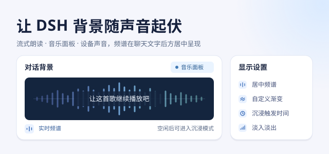

# DSH 音频响应



面向 DeepSeek Harness Web 和 Desktop 的音频响应主题。流式朗读、`dsh-music-panel` 音乐、设备声音、宿主听写（语音输入）与麦克风都可以驱动 audioMotion 频谱。频谱按整个视口居中，放在对话内容后面。

以本地最新 DSH `0.2.2-rc.5`（`2e39e70496`）源码为基线，相关插槽、DOM 锚点、主题令牌与宿主控件样式均按该版本核对。使用 Node.js 24.9+ 和 pnpm 11.28.5。

```sh
pnpm install --frozen-lockfile
pnpm check
pnpm release:check
pnpm pack --pack-destination .release
```

打包文件位于 `.release/`。确认版本号后，在仓库根目录运行 `pnpm publish` 发布到 npm（公开包，默认 `latest` 标签）。

安装主题包。已有正常工作的 TTS 联动可以继续使用。音乐联动已对照 `dsh-music-panel@0.37.2` 的两个播放器检查。

```powershell
dsh plugin --profile desktop add '绝对路径/dsh-audio-reactive-0.1.2.tgz'
```

重载宿主并确认主题已启用。在「设置 → 音频响应」可以预览信号并查看当前来源。「声源设置」按音源列出「流式朗读」「音乐面板」「语音输入（听写）」「麦克风」开关，并保留本机/共享设备采集；使用宿主听写录音时，插件会共享默认输入设备驱动频谱（可在「声源设置 → 麦克风设备」另选输入设备），转写阶段自动回到静态状态，且不会干扰宿主录音。设置页顶部固定显示效果预览，右下角可「按住透视」查看对话区的实时效果或「恢复默认」；下方用分段标签切换显示效果、声源设置、频谱声道、外观色彩和高级设置。「显示效果」内置十余个命名预设（默认柔光、极简曲线、圆环脉冲、镜像声波、霓虹棱镜等），也可以逐项微调。按钮、开关、胶囊选项与输入框沿用宿主控件样式。播放音乐面板里的曲目即可自动接入，无需打开其自带的可视化。部分跨域媒体可能不提供可读取音轨，可改用设备声音采集。

Windows DSH Desktop 里，在「设置 → 音频响应 → 设备声音」点「采集本机声音」，然后在设备上播放声音。采集跟随启动时的默认输出设备，切换扬声器或耳机后可先停止再开启。Web 端也可以点「共享音频」，在浏览器的选择器里选标签页或整个屏幕，并勾选共享对应的音频。采集只分析声音，关闭或停用插件时会释放采集。

「无操作时进入沉浸模式」默认开启，持续播放且达到所设时间会淡入全屏遮罩。遮罩使用宿主当前背景色，透明度与模糊可调（默认透明度 90%、模糊 5px），也可以上传自定义背景图并选择铺满裁切、完整显示、拉伸、原始大小或平铺，再调整缩放比例。触发时间为 1 至 600 秒，默认 15 秒，淡入淡出默认 360 毫秒。鼠标、按键、滚动、触摸、暂停或停播会触发淡出，因此不设退出按钮。宿主弹窗、录音和系统的减少动态效果会阻止进入沉浸模式。[使用与开发细节](docs/DETAIL.md)

[DSH 官方装饰模板](https://github.com/deepseek-ai/deepseek-harness/tree/dsh-v0.2.2-rc.4/packages/preset/agent-preset/skills/dsh-doc/templates/decoration)
