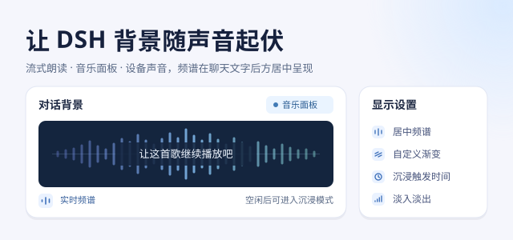

让流式朗读、音乐面板、设备声音、宿主听写或麦克风驱动聊天背景的居中频谱。在 DSH 的「设置 → 音频响应」调整频谱样式、渐变、能见度与沉浸背景；「声源设置」可逐路开关流式朗读、音乐面板、语音输入（听写）与麦克风，使用宿主听写时频谱会跟随麦克风。设置页顶部固定显示效果预览，右下角可按住透视查看对话区的实时效果，下方用分段标签切换显示效果、声源设置、频谱声道、外观色彩和高级设置。「显示效果」内置十余个命名预设（默认选中「默认柔光」），也可以逐项微调，并保存为自己的预设或导入导出 JSON。

开启无操作沉浸后，持续播放达到设定时间便会以宿主背景色淡入全屏遮罩，透明度和模糊可调；也可以上传自定义背景图并设置铺放方式和缩放。移动鼠标、按键、暂停或停止播放会淡出。

Windows Desktop 可在设置中手动开启本机声音采集。网页端可使用浏览器提供的音频共享。
